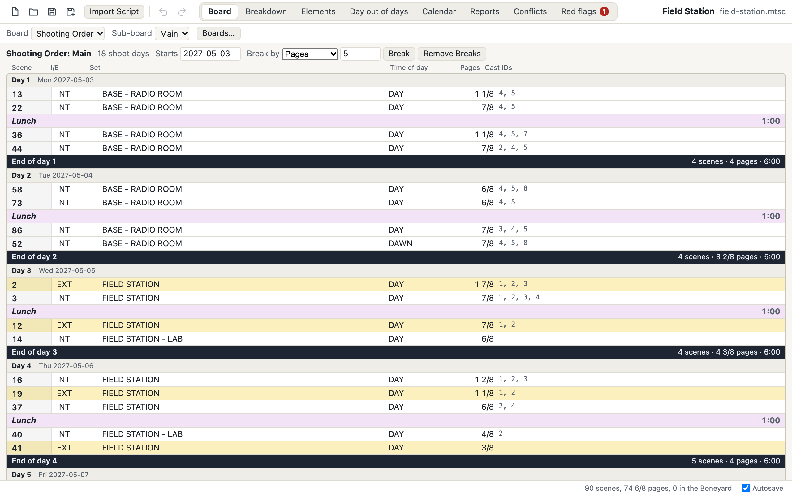
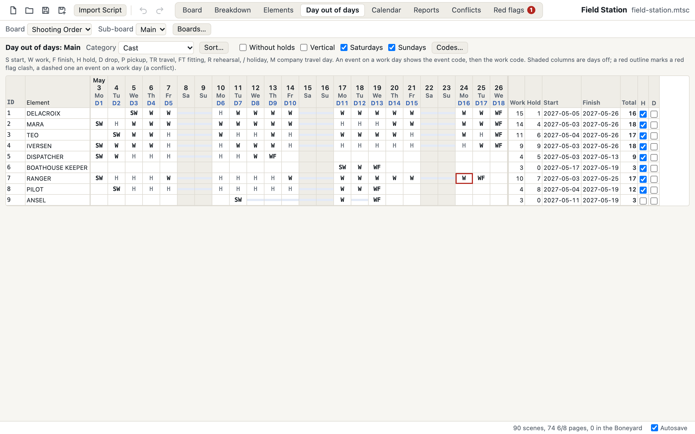
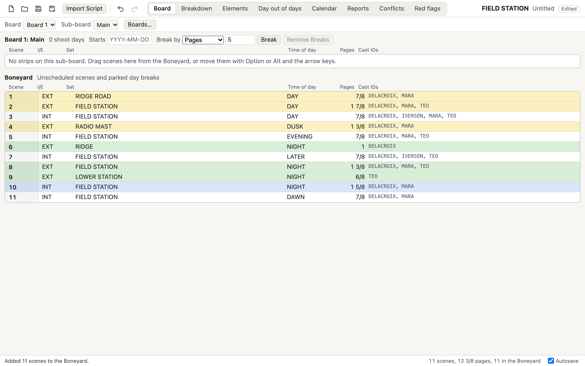
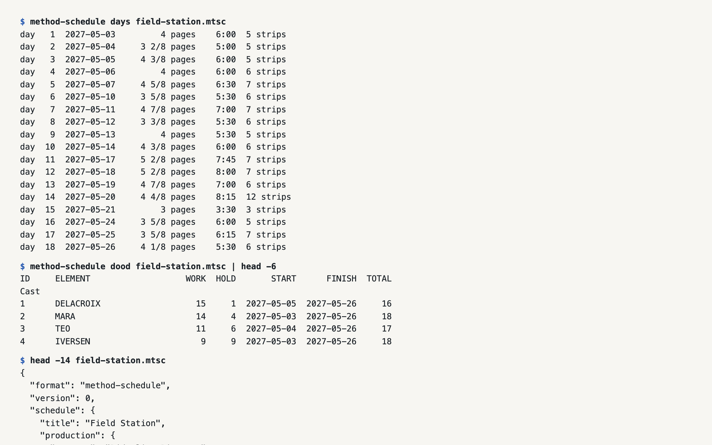

# Method Schedule

Film and TV scheduling, from script to stripboard.

A free, open-source scheduling app for film and TV: script breakdown, the stripboard with
its day breaks and banners, the calendar, the day out of days and the reports a
production runs on. No subscription, and your schedule is a file you own.

- **Every count explains itself.** Ask why an actor works seven days and holds one, and
  the day out of days answers date by date: which scenes, which rehearsal counted as
  worked, which gap was held and why there was no drop (`method-schedule explain`, or
  Cmd+I in the app).
- **Shoot days go to the budget.** File > Export for Budget writes the shoot days and
  each element's work, hold and travel days to one small file with a published spec
  ([docs/EXCHANGE.md](docs/EXCHANGE.md)), written for
  [Method Budget](https://methodbudget.com) and open to any budgeting app.
- **Bring your scripts with you.** A Fountain or `.fdx` script comes in as one breakdown
  sheet per scene, and later drafts merge into the schedule you already have.

Status: early alpha, not released yet; it builds from source today.
Website: [methodschedule.com](https://methodschedule.com).

<picture>
  <source media="(prefers-color-scheme: dark)" srcset="assets/screens/board-dark.png">
  
</picture>

## Yours to keep

- **Free, for good, and open source** (MIT OR Apache-2.0). No account and no
  subscription.
- **Your schedule is a plain file on your own disk**: a `.mtsc` file of documented JSON
  ([the spec](docs/FORMAT.md)) that you can open in 20 years, whatever happens to any
  company or to this project.
- **Works offline.** Nothing is uploaded; the app goes online only to check for a newer
  version of itself, and you can turn that off.
- **Nothing invents your schedule.** There is no generative AI in the app: every count
  comes from rules you can read and ask about.

## Status, honestly

| Computer | Built | Signed | Tested |
| --- | --- | --- | --- |
| Mac, Apple silicon | Yes, an app (`.dmg`) | Signed and notarized by Apple, from the first release | By a person throughout development, and by the automated tests weekly |
| Mac, Intel | No: the Mac app is for Apple silicon only | | |
| Windows, 64-bit | Yes, an installer (`.exe`) | Not yet: Windows will warn that the publisher is unknown | Automated tests weekly; never installed by a person yet |
| Linux, 64-bit | Yes, `.deb` and AppImage | Not signed | Automated tests on every change; never installed by a person yet |

Not there yet: a published release (the first is being prepared), updates inside the app
on Windows and Linux, a hands-on check of printing, keys and file types on Windows and
Linux, and linking a schedule from inside Method Budget. The full list is under
[On the roadmap](#on-the-roadmap). Windows and Linux: help us get there.

## Help build it

**If you make films:** check the day out of days against your experience and tell us
where a count differs from what you would expect (the app's explanation of that count
helps us find out why); tell us about the board and report layouts your productions use;
and contribute invented sample schedules. Help > Report a Bug in the app opens a
prefilled issue, or [open one here](https://github.com/method-production-suite/method-scheduling/issues/new/choose).
Never attach or quote a real schedule or script: an invented one that shows the problem
is always enough, and `method-schedule sample` makes one.

**If you write code:** start with an issue labelled
[good first issue](https://github.com/method-production-suite/method-scheduling/labels/good%20first%20issue).
`cargo test --workspace` checks everything, and [CONTRIBUTING.md](CONTRIBUTING.md) covers
the rest.

Found a bug? [Open an issue](https://github.com/method-production-suite/method-scheduling/issues) (Help > Report a Bug fills one in for you). Have a
question? Ask in [Discussions](https://github.com/method-production-suite/method-scheduling/discussions). For anything private, write to
[hello@methodproduction.com](mailto:hello@methodproduction.com).

Method Schedule is part of the [Method Production Suite](https://methodproduction.com):
free, open tools for making films, from the first draft to the last shoot day.

## Platforms

| Computer | Download | Status |
|---|---|---|
| macOS, Apple silicon | `Method-Schedule-macOS.dmg` | Not released yet: build it from source (below). The app is checked by hand on a Mac. |
| Windows, x64 | `Method-Schedule-windows-x64-setup.exe` | Built by CI, never installed by a person yet. Reports welcome. |
| Linux, x64 | `Method-Schedule-linux-amd64.deb`, `Method-Schedule-linux-x86_64.AppImage` | Built by CI, never installed by a person yet. Reports welcome. |

## A look around

Every picture here is the app showing Field Station, an invented production (the suite's
shared sample, `fixtures/field-station.mtsc`), retaken by `node scripts/capture-screens.mjs`.

<picture>
  <source media="(prefers-color-scheme: dark)" srcset="assets/screens/dood-dark.png">
  
</picture>

<picture>
  <source media="(prefers-color-scheme: dark)" srcset="assets/screens/import-dark.png">
  
</picture>

<picture>
  <source media="(prefers-color-scheme: dark)" srcset="assets/screens/cli-dark.png">
  
</picture>

## Get the code

<!-- clone:start (generated by scripts/site.py from docs/features.toml: edit that, then run python3 scripts/site.py) -->
```bash
git clone https://github.com/method-production-suite/method-scheduling.git
```
<!-- clone:end -->

Then, from the checkout, with [Rust](https://rustup.rs) installed:

```sh
cargo test --workspace
cargo run -p method-schedule-cli -- help
cargo run -p method-schedule-app
```

Schedules are open, documented JSON files (`.mtsc`, docs/FORMAT.md) that diff and merge
cleanly (docs/MERGE.md). Day counts go to Method Budget and other budgeting tools through
the exchange file (docs/EXCHANGE.md), and coding agents can work on schedules through an
MCP server (docs/MCP.md). The command
line and the MCP server also find and replace text across a schedule and list elements
booked on one date in two sub-boards (`method-schedule find`, `replace`, `conflicts`).

## Features

Everything below is built and in the code today; the list is generated from
docs/features.toml.

<!-- features:start (generated by scripts/site.py from docs/features.toml: edit that, then run python3 scripts/site.py) -->
### Breakdown

- **Script import.** Bring in a Fountain or `.fdx` script: one sheet per scene, its heading split into I/E, set and time of day, its length in eighths and its speaking characters as cast.
- **Breakdown sheets.** Scenes, I/E, set, time of day, pages, shoot time, synopsis, location and the rest of the header, with the values other sheets use offered as you type.
- **Elements by category.** Tag cast, props, vehicles and the rest by typing under a category or in one quick-add field, and cut, copy and paste them between sheets.
- **Element manager.** Board IDs, notes, custom properties, images and linked elements, with merge, move and renumber, and each element's scenes, pages, work days and dates.
- **Category settings.** Automatic board IDs, default holds and drops, daily quantities, and leaving a category or a single element off the board.
- **Quantities per scene.** Count background, stand-ins or animals scene by scene and see each day's total.
- **Split and merge sheets.** Duplicate a sheet to split a scene, or merge several sheets into one.
- **Breakdown designer.** Choose the order, visibility and width of the header fields, kept in the schedule.
- **Images on scenes and elements.** Attach pictures to sheets and elements and see them beside the board; the files stay where you keep them.

### Board

- **Stripboard by drag or keys.** Drag strips, or move them with the keyboard, within a sub-board, between sub-boards and into the Boneyard, and cut, copy and paste them.
- **Boards and sub-boards.** Several boards for different orders, each with sub-boards for units or blocks and a Boneyard of unscheduled strips.
- **Day breaks.** Insert them by hand or break the days by pages, shoot time or screen time; each shows its day, date, pages and time.
- **Banners.** Lines across the board for moves, meals and notes, with a duration that counts in the day and a color, size and alignment of their own.
- **Strip designer.** Strip and text colors by I/E and time of day, up to four lines a strip with merged cells, and a layout library shared with the one-line report.
- **Sort and find.** Sort strips by up to three fields, and find strips with a highlight you step through.
- **Split screen.** Put the breakdown, another board, the calendar or the scene's images beside the board, or the images beside the breakdown, and back to one view in a click.
- **Print the board.** Print all or selected strips, with or without the Boneyard, or save the board as a PDF.

### Day out of days

- **The full grid.** Every element's start, work, hold, drop and finish, day by day, for each sub-board and category, with a summary.
- **Counting rules that hold up.** Holds between work days, one drop over the longest gap, travel, fittings and rehearsals as worked days, and holidays and company moves only inside a held span.
- **Explain this count.** Ask why an element's counts are what they are and get the answer date by date.
- **Your codes, sorts and views.** Your own code letters, multi-key sorts, a vertical view, a view without holds, and hold and drop switches on every row.
- **Header fields as categories.** Read-only rows for each set, location, unit, episode, I/E, time of day, script day and sequence value with their sheets, pages, work days, start and finish.

### Calendar and events

- **A calendar per sub-board.** Start date, working week, off days, holidays and company travel days, with shoot days moving around them on their own.
- **Month and weeks views.** One month or every week of the schedule in one list, with strips, banners, pages and length on each day, switches for what each day shows, an actions menu on any date, and a filter by category and element.
- **Events.** Travel, fittings, rehearsals, unavailable days, camera tests and post-production work over a date range, in one of ten colors, made from an element or a sheet and dragged on the calendar.
- **Conflicts.** An element booked on one date in two sub-boards, or an event on a work day, is marked on the strips, the calendar, the day out of days and the elements table.
- **Red flags.** Flag several elements on several dates at once, with standard types that match the event kinds, see every flag in one table and every place the schedule clashes with them.
- **Prep and wrap dates.** Record each sub-board's prep start and wrap end for the budget.

### Reports and exports

- **The reports a production runs on.** One-line, shooting schedule, day out of days and its summary, element list, breakdown and calendar.
- **More reports.** Breakdown by day, element detail, daily category totals, the vertical one-line with its cast grid, conflicts, red flags and a multi-unit one-line merged by date.
- **Report designer.** Columns on up to four lines with merged cells, header layouts with your production info, date ranges and named copies, all kept in the schedule.
- **PDF.** Print any report or save it as a PDF.
- **Excel and CSV.** One-line, day out of days, elements, breakdown, element detail and the whole board as workbooks whose totals are working formulas, or as CSV.

### Files and safety

- **Open file format.** Schedules are `.mtsc` files: plain, documented JSON that diffs cleanly and that any tool can read.
- **Never lose work.** Autosave into the file, a recovery copy for a schedule not saved yet, rolling backups and a restore after a crash.
- **Undo.** Every change is one step, up to 200 of them.
- **Templates and layout files.** Start a schedule from a template of your categories, elements, boards and layouts, and share layouts as files.
- **Several windows.** One schedule per window, each with its own undo, autosave and recovery, and a list of recent files.
- **What changed and merge.** See every change between two schedules in plain words, and merge two copies that changed apart, with real clashes listed for you to pick.

### Keyboard and command line

- **Keyboard first.** Move strips, insert day breaks and banners, step through sheets and switch tabs from the keyboard; a shortcut sheet lists every key.
- **Find and replace.** Search the text fields, replace in the results, or build a search from field, comparison and value rows.
- **Scriptable command line.** `method-schedule` imports scripts, sets day breaks and writes the reports as text, CSV or Excel, with no window and no network.
- **Coding agents.** An MCP server lets coding agents read and edit schedules through the same engine, only in the folders you allow.
- **Git merge driver.** Keep schedules in git and let `method-schedule merge-driver` combine two people's edits, flagging only real conflicts.

### Beyond the usual stripboard

- **Budget exchange file.** Shoot days and every element's day counts as one small, documented file, written for Method Budget and open to any budgeting app.
- **Production tags from the script.** Bring in the props, wardrobe and other tags a tagged script already carries as elements.
- **Script revisions.** Merge a revised draft into the schedule: scenes keep their tags and places, new ones go to the Boneyard and cut ones are marked omitted.
- **Day timeline.** Each shoot day from its call time, strip by strip, with warnings for a long day or a scene past sunset, and what runs past wrap moved to the next day in one step.
- **Sunrise and sunset.** Give each location its coordinates and see sunrise and sunset for every dated shoot day, with the US and Canada or EU daylight saving dates.
- **Rest checks.** Set a turnaround per category and get a warning wherever a rest between wrap and the next call is too short.
- **Schedule locks and drift.** Lock the schedule as sent, then see each actor's work days added, dropped and moved since.
- **Strip order suggestion.** A suggested order that groups by location, set and cast around your pinned strips and red flags, with the before and after counts to compare.
- **Call sheet data.** A shoot day's call sheet data as JSON or CSV, ready for whatever lays out your call sheets.
- **A printed call sheet.** A shoot day's call sheet printed or saved as a PDF: call and wrap, sunrise and sunset, the scenes with their times, the cast on set, other elements and notes.

### On the roadmap

- **Signed Mac app with updates.** A downloadable Mac app, signed and notarized by Apple, that keeps itself up to date.
- **Windows and Linux, tested.** Both build from the same code today; printing, keys and file types still need a hands-on check.
- **Day counts into Method Budget.** Linking a schedule from inside Method Budget, so shoot days and cast days arrive as the budget's globals; its reader for the exchange file is already built.
- **Try it in your browser.** The app with an invented schedule, running in the browser with nothing to install.
- **Daylight saving per location.** Sunrise, sunset and call times that follow each location's clock changes.

<!-- features:end -->

## More

Feature parity with the reference product is tracked in docs/parity/PARITY.md; the plan from here is in docs/ROADMAP.md.

Not affiliated with Entertainment Partners or Movie Magic Scheduling.

Licensed under either of MIT or Apache-2.0, at your option.
Copyright (c) 2026 Method Production Suite Team and the Method Schedule contributors.
