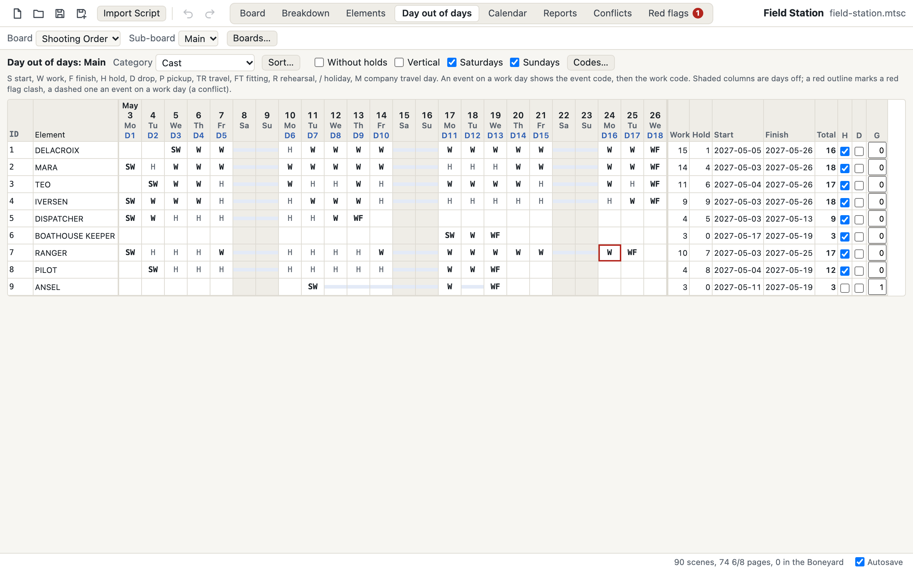

# Method Schedule 0.9.0

Method Schedule makes safer choices about the files it reads and how each release reaches you. It also explains a single day of the day out of days from a right-click, and lets you search the Boneyard on its own.

## More from the day out of days

- **Explain one day.** Right-click a cell and choose Explain with its date. The Explain This Count panel opens with that day marked in the grid and its line in Day by day scrolled into view. It works with the grid either way up.
- **Set a minimum drop gap from the row.** A G box beside each row's H and D switches holds the element's minimum drop gap in days. Press Enter or leave the box to set it, Escape to put it back, and Undo takes it back in one step.

## Find in the Boneyard alone

- **The Boneyard in Where.** Find's Where list now offers the shown board's Boneyard. A search there looks only at its unscheduled scenes and their elements, and Replace there leaves every sub-board as it was.

## Fixed

- **A picture path that points at another computer is no longer followed.** An element's, sheet's or location's picture stored with such a path shows as missing, as a network share on Windows already did, so opening a schedule never reaches out to another machine.
- **Only plain files are read, and never past the size limit.** Method Schedule checks that a file is an ordinary file on your disk before and after opening it, and stops at the limit even if the file grows while it is read.
- **A schedule file opens only if it saves back the same.** A file that marks itself as not a template in a way the app never writes is refused with a sentence saying what to change, instead of opening and then saving differently.
- **Published downloads stay as published.** Once a release is out, its files are never replaced, so what you check against the signed checksum list is what was released. The keys that sign Method Schedule are used only by the release builds.
- **A location's map must be a picture.** Choosing a file that isn't one is refused, from the app, the command line and the MCP server alike. A map set to another file by an earlier version still opens and prints as "Map not found".
- **The Vertical day out of days keeps its heading.** Marking a date from the Explain This Count panel no longer redraws the across heading over the grid on its side.

## Known gaps

- The map on a call sheet is the picture you choose. A missing picture prints as "Map not found" with its path.
- On an Intel Mac, the app has been tested by the automated tests, run the way an Intel Mac runs them, but not yet by a person on one.
- Windows and Linux builds are made and tested automatically, but nobody has installed them by hand yet. Not signed, and no certificate is planned: Windows warns that the publisher is unknown before it opens.
- On Windows and Linux, opening a second file while the app is running starts a second copy of the app.
- Printing uses Letter paper only.

## Thanks

- Everyone who has tried Method Schedule so far. Bugs go to Issues and questions to Discussions, both on GitHub.
